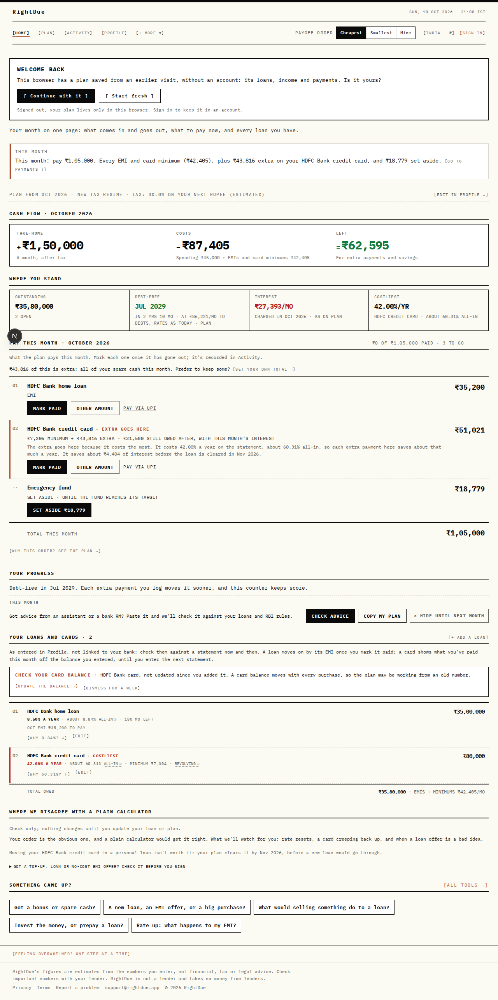
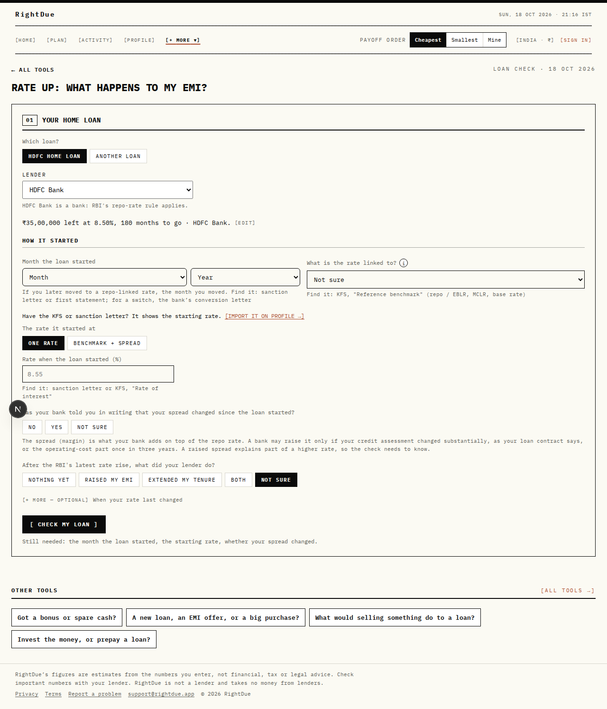

# RightDue: figure consistency and UX audit

Seed: the India demo household, debt budget “all spare cash”, marginal rate 30%.
HDFC home loan ₹35,00,000 at 8.50% for 180 months, EMI ₹35,200.
HDFC credit card ₹80,000 at 42% (statement), usual payment ₹4,000.
Rendered signed-in at 1280px and 390px. The same strings are asserted in
`web/tests/every-section.cjs`. Golden E2E repeats the identity check after
setup in `web/e2e/every-section.spec.ts`.

## What was wrong, and what changed

The card’s minimum was two numbers on one Home screen.

- Pay this month, Activity and Can’t pay said **₹7,205**. That is what the
  plan collects: the bank’s formula on the interest this cycle actually
  charges (average daily balance, payment on the due date).
- The loan row and Profile said **₹7,304**. That is a full month of interest
  on the whole balance, then the same formula. ₹99 more.

₹35,200 + ₹7,205 = ₹42,405, which is the “EMIs and minimums” line. The loan
row’s ₹7,304 did not add up to that line. Profile, the loan-form explainer
(“the plan always pays at least this”), the monthly recap and a missed-payment
check all used the ₹7,304 estimate.

They now use `minimumDueThisMonth`, the same fixed-point the engine uses
(`card_minimum_at_charged_interest`). The bank-formula estimate remains
available for the golden mirror of `compute_minimum_payment`; it is no longer
what the screens call “the minimum”.

Loan check said “8.5%” for the same rate Home, Profile, Can’t pay, Sell to
repay and NRI prepay show as **8.50%**. The summary line now uses two decimals.

## Figures that already agreed

Checked on the seed, before and after the minimum fix:

| Figure | Value | Where it matched |
| --- | --- | --- |
| Total owed | ₹35,80,000 | Home, Plan schedule, Profile |
| Home loan balance | ₹35,00,000 | Home, Plan, Profile, Loan check, NRI prepay |
| Card balance | ₹80,000 | Home, Plan, Profile |
| Home EMI | ₹35,200 | Home, Plan, Profile, Activity, Can’t pay |
| EMIs + minimums | ₹42,405 | Home, Can’t pay (35,200 + 7,205) |
| Sent to debts this month | ₹86,221 | Home, Plan, Can’t pay |
| Pay this month, including set-aside | ₹1,05,000 | Home, and the same spare-cash figure on Update-your-numbers |
| Card statement rate | 42.00% | Home, Profile, Sell to repay |
| Card all-in cost | 60.31% | Home, Plan, Invest or prepay |
| Home all-in cost | 8.84% | Home, Plan, Invest or prepay |
| Take-home | ₹1,50,000 | Home, Plan, Profile |
| Spending | ₹45,000 | Home, Plan, Profile, Assumptions |
| Marginal rate | 30% / 30.0% | Home, Plan, Profile, Tax, Invest or prepay, Assumptions |
| Interest over the plan | ₹4,98,321 | Plan, Profile payoff order |
| Debt-free | July 2029 (2 years 10 months) | Plan headline, Home card, Profile (“Jul 2029”) |
| Principal + interest | ₹40,78,321 | Plan schedule (35,80,000 + 4,98,321) |
| One missed EMI’s interest | ₹249 | Can’t pay (35,200 × 8.50% / 12, rounded) |
| Cash flow | 1,50,000 − 87,405 = 62,595 | Home. 62,595 = 43,816 extra + 18,779 set aside |

`/tools/recompute` opens Plan. `/tools/cash-yield` opens Spare cash. Both
show that page’s figures, not a second calculation.

## Section inventory

Every route, and the sections on it that show or derive a figure. “Same” means
the seeded strings above. “Own” means a figure that is not repeated elsewhere
and was checked against its own formula. “None” means the page must not show
this household’s ₹35,80,000.

| Id | Kind | What it shows |
| --- | --- | --- |
| `/` Home | screen | Same: owed, EMI, minimum, dues, all-in rates, cash flow |
| Home · cash flow | section | Take-home, costs ₹87,405, left ₹62,595 |
| Home · where you stand | section | ₹35,80,000, Jul 2029, ₹86,221/mo |
| Home · pay this month | section | EMI, minimum, extra, emergency fund, total ₹1,05,000 |
| Home · your loans and cards | card | Balance, 8.50%, 8.84%, 42.00%, 60.31%, minimum ₹7,205 |
| Home · your progress | section | Debt-free month, same as Plan |
| Home · where we disagree | section | The 60.31% and 8.84% costs again |
| `/plan` | screen | Debt-free July 2029, interest ₹4,98,321, ₹86,221 |
| Plan · trajectory | section | Opening ₹35,80,000 drawn down |
| Plan · month by month | section | Start balance, principal + interest = ₹40,78,321 |
| Plan · what if | section | Same EMI ₹35,200 under a 0.25 point move |
| Plan · advance tax | section | Salaried note; no second interest total |
| `/activity` | screen | This month’s EMI, minimum and extra, as on Home |
| `/profile` | summary | Loans, income, spending, debt-free, interest |
| Profile · you / tax | section | 30.0% |
| Profile · income | section | ₹1,50,000, ₹45,000 |
| Profile · loans | section | Both balances, EMI, minimum, total |
| Profile · payoff order | section | Jul 2029, ₹4,98,321 |
| Profile · loan form | modal | Plan minimum ₹7,205, not the full-month estimate |
| `/profile/assets` | screen | None until a holding is added |
| `/profile/assumptions` | screen | Spending ₹45,000, 30% to the fund |
| `/onboarding` | screen | Spare cash ₹1,05,000, same as Home’s pay line |
| `/portfolio` | screen | None on this seed (no holdings) |
| `/tax` | screen | 30.0%; loan-tax figures are this page’s own |
| `/goals` | screen | None of the loan totals; tools listed beside goals |
| `/cant-pay` | screen | Dues ₹42,405, still to pay ₹86,221, EMI, minimum, ₹249 |
| Can’t pay · protect / cost / letter | sections | The same dues; the letter adds no new balance |
| `/cant-pay/us-letters` | screen | None (US letters; this seed is India) |
| `/glossary` | screen | Worked examples only (42%, ₹2), not this household |
| `/login` | screen | None |
| `/privacy` | screen | None |
| `/terms` | screen | Sample ₹1,000 / $15, not this household |
| `/rbi-decision` | screen | Repo 5.25% → 5.50%. Does not rewrite this EMI |
| `/tools/windfall` | screen | After an amount, the seeded card (60.31%), not ₹7,304 |
| `/tools/new-debt` | screen | Offer rates for a loan not yet taken |
| `/tools/liquidate` | screen | 8.50% and 42.00%, the seeded rates |
| `/tools/invest-vs-prepay` | screen | 60.31%, 8.84%, 30.0% |
| `/tools/loan-check` | screen | ₹35,00,000 at 8.50% |
| `/tools/nri-prepay` | screen | ₹35,00,000 at 8.50%, 180 months |
| `/tools/recompute` | redirect | Plan |
| `/tools/cash-yield` | redirect | Spare cash |
| `/account` | screen | None |

## Walkthrough: “what do I pay this month?”

1. Home opens on one sentence: pay ₹1,05,000, of which ₹42,405 is EMIs and
   minimums, ₹43,816 is extra on the card, ₹18,779 is set aside. The rows
   under it repeat those amounts. They add up.
2. The loan list used to repeat the card minimum as a different number. It
   now says ₹7,205, the same as the row above and as Activity and Can’t pay.
3. Plan answers “when am I done?”: July 2029, ₹4,98,321 of interest, and the
   schedule’s principal equals ₹35,80,000 owed today.
4. Profile is the place to correct a figure. The loan summary shows the same
   balances, EMI, rate and minimum. The payoff line shows the same month and
   the same interest.
5. Can’t pay, if this month is short, starts from the same ₹42,405 and
   ₹86,221. It does not recompute a second household.

## Nielsen, from this pass

1. **Status.** Home leads with this month. Plan leads with the debt-free
   date. Both are visible without opening anything.
2. **Real world.** EMI, minimum, GST and “all-in” are named. Two different
   “minimums” broke that. Fixed.
3. **Control.** Debt budget, what-if, and edit links are on the page that
   uses them. The plan does not change the EMI you typed.
4. **Consistency.** Rates agree at two decimals (8.50%). Dates use one
   formatter: long in a sentence (“July 2029”, “18 July 2029”) and short on
   a tile (“Jul 2029”, “18 Jul 2029”). A section heading no longer shouts
   the month. Tax slabs stay one decimal (30.0%) because they are a slab,
   not a loan rate.
5. **Error prevention.** Loan check, new-debt and sell-to-repay are checks
   before a decision. They read this household’s rate rather than a sample.
6. **Recognition.** Four tabs, and More grouped as Money, Tools, Help.
7. **Flexibility.** Each tool answers one question and links back. Recompute
   and cash-yield are old addresses that land on Plan and Spare cash.
8. **Aesthetic.** One column, mono labels, rupee figures. A few danger
   colours fall back to different reds (`#b00020`, `#b91c1c`, `#b42318`)
   when the token is missing. Not changed here.
9. **Help.** “Why 60.31%?” opens on the card. Glossary and Can’t pay are
   reachable signed out.
10. **Recovery.** A short month has Can’t pay and a letter. The interest on
    a missed home EMI is the loan’s own rate, ₹249, not a generic penalty.

## Order worth using

For a first sitting, the useful order is the one the tabs already suggest:

1. Setup: income, then the loans.
2. Home: pay this month, then the loan list to check the rate.
3. Plan: the date, then the schedule, then what-if.
4. Profile, only to correct a number the plan is using.
5. A tool, from the question (“got a bonus?”, “rate up?”), not from a directory.
6. Can’t pay, only in a month that is short.

Portfolio and Goals stay empty until there is something to put there. That
is clearer than a zero that looks like a calculated balance.

## Left as they are

- Plan’s chart axis says ₹35.80 beside the full ₹35,80,000. The full figure
  is on the same page. A chart label in lakh is fine next to the full rupee.
- Update-your-numbers shows ₹1.5 next to ₹1,05,000. The ₹1,05,000 matches
  Home. The compact lakh is the income field’s own format.
- Assumptions says “30%” and Profile says “30.0%”. Same rate.
- The signed-out landing uses its own example (₹47,30,000), not this
  household. It should keep doing that.

## Signed-out pages, checked after the walk

A pass over the public pages reported the India plan chart ending at “$0 · Nov 2035”. That string is the US example, in the block marked for the US (`data-c="US"`). The India chart in the same file ends at “₹0 · May 2032”. The page hides the other country’s block. The two examples are not one chart with a mixed currency.

The same pass could not open Plan, Activity, Profile or the tools behind sign-in, so it could not compare those figures. That comparison is the seeded render above.

What it read as separate bugs, and why they stay:

- Home, Plan, Activity and Profile in the public masthead send a signed-out visitor to sign-in. That is the gate. Glossary, Loan check, Can’t pay, the RBI page, privacy, terms and Your data stay open.
- The landing’s India/USA switch, Can’t pay’s India/USA buttons, and the glossary’s country note do different jobs. They are not one control drawn three ways.
- “MARK PAID” on the India example and “PAID” on the US example are the two countries’ words for the same action.
- The landing uses the same two date forms as the app: long in a sentence, short on a tile (“May 2032”, “Oct–Nov 2027”). It does not shout the month or drop the century.

## One format for dates, money and rates

`formatMonth` in `web/src/lib/today.ts` is the only way a month is written.

- Long, in a sentence or a heading: “July 2029”, “18 July 2026”.
- Short, on a tile or in a column: “Jul 2029”, “18 Jul 2026”.

Neither is uppercased, and neither drops the century. “JUL 2029” and “Oct ’26” are gone, including on the signed-out landing. A section heading still uses small caps for the words around the date; the month itself is left in its own case, so Home reads “CASH FLOW · October 2026” and “PAY THIS MONTH · October 2026”.

Money stays on `formatCurrency` / `formatCurrencyWhole`. A loan or return rate stays on `formatPct`, two decimals (“8.50%”, “42.00%”, “60.31%”). A tax slab stays one decimal (“30.0%”) because it is a slab, not a loan rate, and the assumptions page’s “30%” is the share of surplus that goes to the emergency fund.

## Signed-in walk, 390px and 1280px

The seeded profile (HDFC home loan ₹35,00,000 at 8.50%, EMI ₹35,200; HDFC card ₹80,000 at 42%) was opened signed in and used, not only screenshotted.

- Home, Plan, Activity, Profile, Goals, Portfolio, Tax and Can’t pay render at both widths with no horizontal overflow.
- Mark paid records the row at both widths.
- Plan’s “spend less each month” accepts 5,000 and keeps the assumptions on the page (no Sec 24(b) on the self-occupied home loan, so 8.84% all-in; the card at 60.31%).
- Profile can add a loan and remove it.
- An empty onboarding (session, no profile) goes from take-home to the loan step. The credit-report upload sits under the loan fields, titled “Credit report PDF, optional”. Typing a loan comes first.

## Accessibility and speed

axe-core (WCAG 2 A and AA) on `/`, `/plan`, `/activity`, `/profile`, `/cant-pay`, `/tools/loan-check`, `/onboarding` and `/goals`, at 390px, signed in: 0 violations before these edits and 0 after.

Lighthouse mobile, production build, simulated throttling (slow 4G, 4× CPU). The dev server’s scores are not the comparison.

Before, the same four routes the owner asked to speed up:

| Route | Performance | Accessibility | LCP | TBT | CLS |
| --- | --- | --- | --- | --- | --- |
| `/` | 90 | 100 | 3.5 s | 60 ms | 0.013 |
| `/plan` | 91 | 100 | 3.5 s | 80 ms | 0 |
| `/cant-pay` | 89 | 100 | 3.7 s | 60 ms | 0 |
| `/profile` | 93 | 100 | 3.1 s | 110 ms | 0 |

Profile had been 76 / 4.0 s / CLS 0.217 when the summary waited for a client effect. The first HTML now contains the figures (₹1,50,000, ₹35,00,000, 8.50%, Jul 2029).

After, measured again on the production build with the seeded profile. The chunk scripts start after the first paint, so a slow phone does not have to download them before the figures. The header date no longer disagrees with the browser’s clock in a way that threw the page away and painted it a second time.

| Route | Performance | Accessibility | LCP | TBT | CLS |
| --- | --- | --- | --- | --- | --- |
| `/` | 100 | 100 | 1.4 s | 70 ms | 0 |
| `/plan` | 98 | 100 | 1.4 s | 170 ms | 0 |
| `/cant-pay` | 98 | 100 | 1.5 s | 140 ms | 0.006 |
| `/profile` | 99 | 100 | 1.2 s | 140 ms | 0 |

Home’s order is unchanged: status first, then the pay list.

First-load JS stayed inside the route budget (a route fails at +10 kB or over 300 kB). Plan is the largest move, 277.7 kB to 280.5 kB. fast-check is a dev dependency, so it is not in that bundle.

Played against a local Postgres the e2e API migrates and seeds. Playwright Chromium: 103 passed, 10 skipped, 0 failed. The every-section inventory (both widths, the full figure list): 1 passed. The web unit suite: 757 passed, 1 skipped.

## Decisions that need the owner

1. Home’s order. The walk recommended pay-this-month first. On 18 Oct 2026 Home was put back to status first: cash flow and where-you-stand, then the pay list. It is still that way. Changing it is a product call, not a bug.
2. A first sitting, if the owner wants it written down as the path: Setup, then Home’s pay line, then the loan list, then Plan (date, schedule, what-if), Profile only to correct a number, one tool for the question in hand, and Can’t pay only in a short month. Portfolio and Goals stay empty until there is something to put there.
3. The credit-report PDF stays in Setup, under the loan fields, and again under Profile → Loans. Whether Setup should keep it is a call.
4. Cash flow’s “left” is ₹62,595. Pay this month is ₹1,05,000. The note says the left figure is for extra payments and savings (₹43,816 + ₹18,779). The two lines are easy to read as two answers. They are one answer split. Wording is the owner’s if they want them to share a phrase.
5. The empty loan block opens as a credit card. A person whose first debt is a home loan changes the kind. Left as it is.
